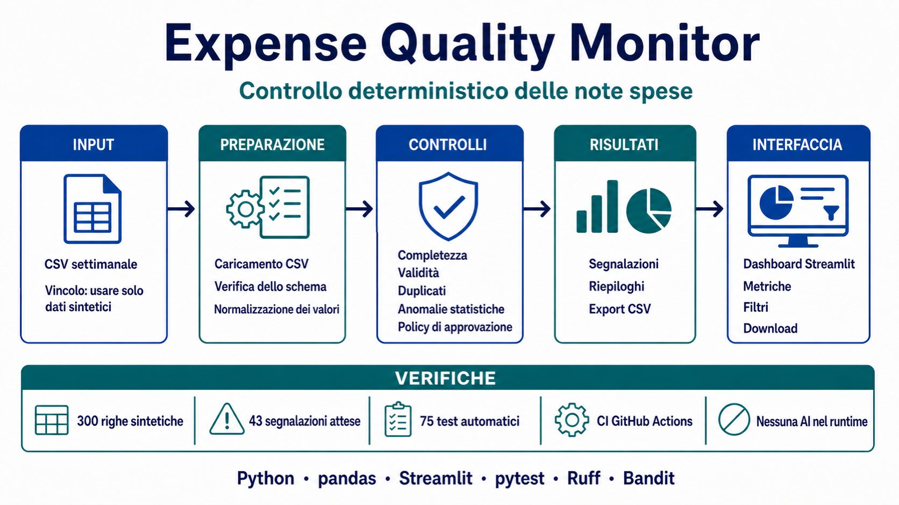

# expense-quality-monitor



Strumento locale per automatizzare il controllo settimanale degli export CSV delle note spese. Il problema affrontato è la presenza ricorrente di dati mancanti, valori non validi, duplicati, importi anomali e spese soggette ad approvazione, oggi verificati manualmente prima del riepilogo per il CFO.

Documentazione finale:

- [Case study](docs/CASE_STUDY.md)
- [Case sheet](docs/CASE_SHEET.md)
- [Guida demo — 20 minuti](docs/DEMO.md)
- [Retrospettiva](docs/RETROSPECTIVE.md)
- [Note di revisione critica](docs/REVIEW_NOTES.md)

## Soluzione

Il progetto implementa un monolite modulare deterministico che:

1. carica il CSV e confronta le intestazioni con lo schema canonico derivato da `EXPECTED_COLUMNS`;
2. conserva i valori originali e crea valori di lavoro normalizzati;
3. applica regole indipendenti di qualità, anomalia e policy;
4. produce segnalazioni ordinate e verificabili;
5. presenta metriche, riepiloghi, filtri e download tramite Streamlit.

Il motore non usa modelli AI nel runtime e non effettua chiamate esterne durante l’analisi.

## Stack e architettura

- Python 3.11 o successivo;
- pandas per caricamento e analisi tabellare;
- Streamlit per la dashboard;
- pytest per test unitari, di integrazione, regressione e interfaccia;
- Ruff per lint e formattazione;
- Bandit per la scansione di sicurezza;
- GitHub Actions per la CI.

L’architettura è un monolite modulare: `pipeline.py` coordina il flusso, mentre caricamento, normalizzazione, regole e reporting restano separati. Questa struttura mantiene semplice l’esecuzione locale e rende ogni controllo verificabile in isolamento.

## Dati e governance

Sono ammessi esclusivamente dati sintetici. Non devono essere caricati dati aziendali, di clienti o di persone reali, né devono essere inviati a strumenti AI.

Il dataset dimostrativo è:

```text
data/synthetic_expenses.csv
```

La relativa ground truth è:

```text
data/expected_anomalies.csv
```

## Controlli implementati

- completezza dei sei campi obbligatori;
- validità di identificativo, data, importo e categoria;
- duplicati per `id_spesa` ripetuto;
- duplicati logici con identificativi diversi e confronto normalizzato;
- anomalie statistiche per categoria oltre tre volte la mediana;
- non valutabilità statistica sotto cinque osservazioni utilizzabili;
- soglie di policy e stato `richiede approvazione`;
- non conformità sopra soglia senza approvatore.

Le regole, le soglie e i messaggi sono centralizzati e deterministici. L’export CSV delle segnalazioni neutralizza valori che potrebbero essere interpretati come formule da un foglio di calcolo.

## Dashboard Streamlit

La dashboard:

- carica un CSV esclusivamente in memoria;
- accetta separatori con virgola o punto e virgola e testo UTF-8 con o senza BOM;
- normalizza BOM, spazi esterni e maiuscole delle intestazioni prima del confronto;
- accetta colonne aggiuntive, che restano escluse dalle regole;
- mostra colonne mancanti, trovate e aggiuntive quando lo schema non è compatibile;
- rileva intestazioni duplicate dopo la normalizzazione;
- offre un modello CSV scaricabile e il dataset locale di esempio;
- mostra righe totali, righe con segnalazioni e segnalazioni complessive;
- presenta conteggi per tipo, stato e categoria;
- ricerca e filtra le segnalazioni per tipo, stato, categoria e regola;
- esporta in CSV la vista corrente.

File vuoti, contenuti illeggibili e schemi incompatibili producono messaggi specifici. Gli errori inattesi non espongono dettagli interni o contenuti del file.

## Risultati verificati

Sul dataset dimostrativo:

- 300 righe sintetiche;
- 37 righe con almeno una segnalazione;
- 43 segnalazioni attese;
- corrispondenza esatta con la ground truth;
- la versione corrente del branch dispone di 75 test automatici.

## Installazione

```bash
python3 -m venv .venv
source .venv/bin/activate
python3 -m pip install -e ".[dev]"
```

## Generazione del dataset

```bash
python3 scripts/generate_dataset.py
```

La generazione usa il seed fisso `20260713`, una settimana sintetica fissa e sovrascrive deterministicamente:

- `data/synthetic_expenses.csv`;
- `data/expected_anomalies.csv`.

## Avvio della dashboard

```bash
streamlit run app.py
```

Per la dimostrazione caricare `data/synthetic_expenses.csv`.

## Test e qualità

```bash
python3 -m pytest -q
python3 -m ruff check .
python3 -m ruff format --check .
python3 -m bandit -r src app.py -c pyproject.toml
python3 -m compileall src tests app.py
python3 -m pip check
```

La workflow `.github/workflows/ci.yml` esegue su push e pull request verso `main` la rigenerazione dei dataset, il controllo delle differenze, i test, Ruff, Bandit e compileall. Non sono previsti workflow CD; il deployment dimostrativo viene configurato separatamente su Streamlit Community Cloud.

## Deployment

L’applicazione può essere distribuita su Streamlit Community Cloud utilizzando:

- repository: `samueldvi/expense-quality-monitor`;
- branch di produzione: `main`;
- entrypoint: `app.py`;
- versione Python: `3.11`.

Il deployment pubblico non è ancora attivo e mantiene il vincolo di utilizzare esclusivamente dati sintetici.

## Struttura del repository

```text
.
├── .github/workflows/ci.yml
├── .streamlit/config.toml
├── README.md
├── TIME_LOG.md
├── app.py
├── data/
│   ├── expected_anomalies.csv
│   └── synthetic_expenses.csv
├── docs/
│   ├── ASSUNZIONI.md
│   ├── CASE_SHEET.md
│   ├── CASE_STUDY.md
│   ├── DEMO.md
│   ├── RETROSPECTIVE.md
│   ├── REVIEW_NOTES.md
│   ├── assets/
│   ├── brief.md
│   ├── dataset.md
│   ├── design.md
│   └── requirements.md
├── pyproject.toml
├── requirements.txt
├── scripts/generate_dataset.py
├── src/expense_quality_monitor/
│   ├── config.py
│   ├── loader.py
│   ├── normalization.py
│   ├── pipeline.py
│   ├── reporting.py
│   └── rules/
└── tests/
    ├── test_app.py
    ├── test_loader.py
    ├── test_package_import.py
    ├── test_pipeline_reporting.py
    ├── test_regression.py
    ├── test_rules.py
    └── test_tool_configuration.py
```

## Limiti e fuori ambito

- analisi limitata a un singolo file settimanale;
- nessuna conversione valutaria;
- nessun dato reale;
- nessuna autenticazione, API, integrazione ERP o database;
- nessuna analisi storica multi-settimana;
- nessun workflow CD e nessun deployment pubblico attualmente attivo;
- il deployment dimostrativo è un’estensione successiva al brief e non rende l’app pronta per dati reali, né aggiunge autenticazione o persistenza;
- nessun modello AI nel runtime.

## Commit e tracciabilità AI

I commit che introducono o modificano contenuto usano i prefissi seguenti. I merge commit creati automaticamente da GitHub costituiscono commit tecnici e possono mantenere il messaggio generato dalla piattaforma.

- `human:` per contenuto principalmente scritto o modificato dalla persona;
- `ai-generated:` per contenuto principalmente generato dall’AI;
- `ai-assisted:` per contenuto realizzato dalla persona con assistenza AI.

Assunzioni e correzioni critiche degli output AI sono documentate rispettivamente in `docs/ASSUNZIONI.md` e `docs/REVIEW_NOTES.md`.
